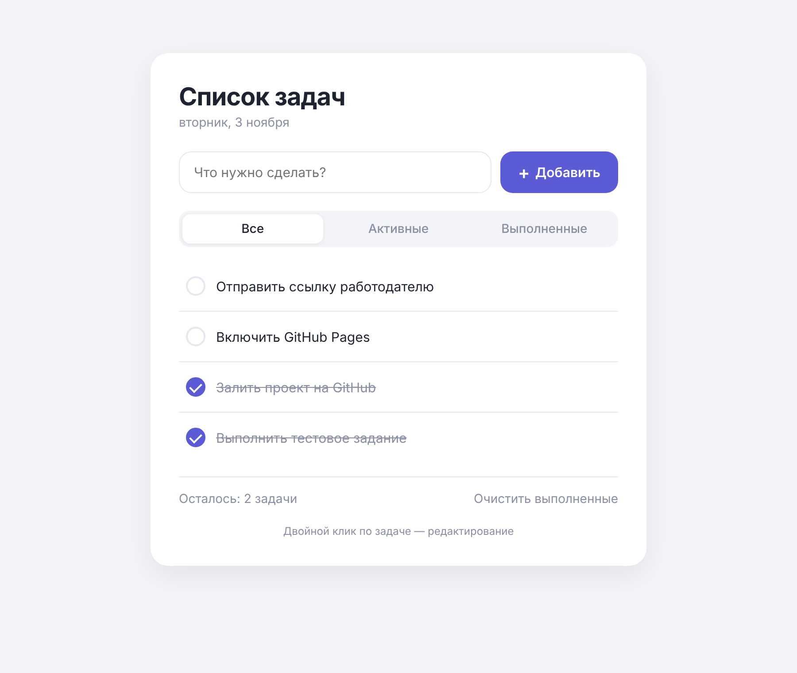

# ✅ Список задач (To-Do List)

Простое и аккуратное веб-приложение для ведения списка задач. Написано на чистом HTML, CSS и JavaScript, без фреймворков и сборки.

🔗 **Рабочий сайт:** https://dimtsy.github.io/todo-list/



## Функционал

**Основное (по заданию):**
- ➕ Добавление новых задач (кнопкой или клавишей Enter)
- ✔️ Отметка выполненных задач
- 🗑️ Удаление задач
- 💾 Сохранение задач после обновления страницы (`localStorage`)

**Дополнительно:**
- ✏️ Редактирование задачи двойным кликом (Enter сохраняет, Esc отменяет)
- 🔎 Фильтры: «Все», «Активные», «Выполненные»
- 🔢 Счётчик оставшихся задач с правильным склонением
- 🧹 Кнопка «Очистить выполненные»
- 🚫 Защита от пустых задач (поле подсвечивается)
- 📱 Адаптивная вёрстка для телефонов
- 🔄 Синхронизация между открытыми вкладками браузера
- 🛡️ Текст задач выводится через `textContent`, что защищает от XSS

## Технологии

- HTML5
- CSS3 (переменные, анимации, адаптивная вёрстка)
- JavaScript (ES6+), без зависимостей
- `localStorage` для хранения данных

## Как запустить

**Вариант 1:** открыть рабочий сайт по ссылке выше.

**Вариант 2:** локально.
```bash
git clone https://github.com/Dimtsy/todo-list.git
cd todo-list
```
Затем открыть файл `index.html` в любом браузере. Установка ничего не требует.

## Структура проекта

```
todo-list/
├── index.html      # разметка
├── style.css       # стили
├── script.js       # логика приложения
├── screenshot.png  # скриншот для README
└── README.md
```

## Использованные AI-инструменты

- **Claude (Anthropic)**: генерация кода приложения (HTML, CSS, JS), автоматическая проверка функционала в браузере (Playwright), написание README.

Я ставил задачу и требования к функционалу и дизайну, проверял результат вручную, публиковал проект на GitHub и GitHub Pages.
